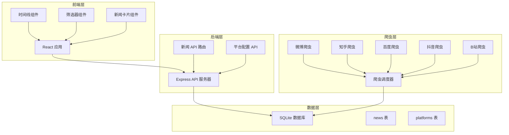

# 设计文档

## 概述

本系统采用前后端分离架构，后端负责新闻爬取、数据存储和 API 服务，前端负责用户界面展示和交互。系统设计遵循模块化原则，便于扩展新的新闻平台。

## 技术栈

### 后端
- **运行时**: Node.js
- **框架**: Express.js
- **数据库**: SQLite（轻量级，适合中小规模数据）
- **爬虫**: Cheerio/Puppeteer（根据平台需求选择）
- **定时任务**: node-cron

### 前端
- **框架**: React + TypeScript
- **样式**: Tailwind CSS（快速实现响应式设计）
- **状态管理**: React Context API
- **HTTP 客户端**: Axios
- **构建工具**: Vite

## 架构设计



## 通用爬虫架构设计

### 设计原则

1. **配置驱动**: 新平台通过配置文件添加，无需修改代码
2. **策略分离**: 不同抓取方式（静态、动态、API）使用不同策略
3. **易于扩展**: 支持自定义解析器和转换器
4. **容错性强**: 单个平台失败不影响其他平台

### 爬虫类型

```typescript
// 三种爬虫策略
abstract class BaseCrawler implements ICrawler {
  constructor(protected config: CrawlerConfig) {}
  
  async crawl(): Promise<NewsItem[]> {
    try {
      const rawData = await this.fetch();
      const parsed = await this.parse(rawData);
      return this.transform(parsed);
    } catch (error) {
      this.handleError(error);
      return [];
    }
  }
  
  protected abstract fetch(): Promise<any>;
  protected abstract parse(data: any): Promise<any[]>;
  protected transform(items: any[]): NewsItem[] {
    // 通用转换逻辑
  }
}

class StaticCrawler extends BaseCrawler {
  // 使用 Cheerio 解析静态 HTML
}

class DynamicCrawler extends BaseCrawler {
  // 使用 Puppeteer 处理动态页面
}

class ApiCrawler extends BaseCrawler {
  // 直接调用 API
}
```

### 配置解析器

支持多种数据提取语法：
- **CSS 选择器**: `.class #id > element`
- **属性提取**: `a@href`, `img@src`
- **JSONPath**: `$.data.items[*].title`
- **正则表达式**: `/pattern/flags`

### 添加新平台流程

1. 在 `platforms.json` 添加平台配置
2. 准备平台图标（SVG 格式）
3. 运行配置导入脚本
4. 测试爬虫是否正常工作
5. 无需重启服务，配置自动生效

## 组件和接口

### 后端组件

#### 1. 爬虫模块 (Crawler Module)

**职责**: 从各平台抓取热点新闻

**接口**:
```typescript
interface ICrawler {
  platformId: string;
  platformName: string;
  crawl(): Promise<NewsItem[]>;
}

interface NewsItem {
  title: string;
  url: string;
  platformId: string;
  publishTime: Date;
  hotScore?: number;
  extra?: Record<string, any>; // 扩展字段，存储平台特有信息
}

// 爬虫配置接口
interface CrawlerConfig {
  type: 'static' | 'dynamic' | 'api'; // 抓取类型
  url: string; // 目标 URL
  selector?: string; // CSS 选择器（static/dynamic）
  apiConfig?: {
    endpoint: string;
    method: 'GET' | 'POST';
    headers?: Record<string, string>;
    params?: Record<string, any>;
    dataPath: string; // 数据在响应中的路径，如 'data.items'
  };
  parser: {
    title: string; // 标题提取规则
    url: string; // 链接提取规则
    time?: string; // 时间提取规则
    hotScore?: string; // 热度提取规则
  };
  rateLimit?: number; // 请求间隔（毫秒）
  timeout?: number; // 超时时间（毫秒）
}
```

**实现策略**:
- 使用**策略模式**实现三种爬虫类型：
  - `StaticCrawler`: 使用 Cheerio 解析静态 HTML（适用于微博、知乎等）
  - `DynamicCrawler`: 使用 Puppeteer 处理动态渲染页面（适用于需要 JS 渲染的网站）
  - `ApiCrawler`: 直接调用平台 API（适用于 GitHub、Hacker News 等提供 API 的平台）
- 使用**工厂模式**根据配置创建对应类型的爬虫实例
- 使用**模板方法模式**定义爬虫执行流程（请求 → 解析 → 转换 → 验证）
- 支持**插件式扩展**：新平台只需添加配置，无需修改代码

#### 2. 调度器 (Scheduler)

**职责**: 管理爬虫任务的定时执行

**接口**:
```typescript
interface IScheduler {
  start(): void;
  stop(): void;
  runNow(): Promise<void>;
}
```

**实现策略**:
- 使用 node-cron 设置每天固定时间执行
- 支持手动触发爬取
- 记录每次爬取的执行日志

#### 3. 数据访问层 (Data Access Layer)

**职责**: 封装数据库操作

**接口**:
```typescript
interface INewsRepository {
  saveNews(news: NewsItem[]): Promise<void>;
  getNews(filters: NewsFilter): Promise<NewsItem[]>;
  deleteOldNews(daysToKeep: number): Promise<void>;
}

interface NewsFilter {
  platformIds?: string[];
  startTime?: Date;
  endTime?: Date;
  limit?: number;
  offset?: number;
}
```

#### 4. API 路由 (API Routes)

**端点**:

1. `GET /api/news`
   - 查询参数: `platforms`, `startTime`, `endTime`, `limit`, `offset`
   - 响应: `{ data: NewsItem[], total: number }`

2. `GET /api/platforms`
   - 响应: `{ data: Platform[] }`

3. `POST /api/crawl/trigger` (管理员接口)
   - 手动触发爬取

### 前端组件

#### 1. App 组件

**职责**: 应用根组件，管理全局状态

**状态**:
```typescript
interface AppState {
  selectedPlatforms: string[];
  newsData: NewsItem[];
  loading: boolean;
  error: string | null;
}
```

#### 2. Timeline 组件

**职责**: 渲染时间线视图

**Props**:
```typescript
interface TimelineProps {
  newsItems: NewsItem[];
  onLoadMore: () => void;
}
```

**特性**:
- 无限滚动加载
- 虚拟滚动优化性能
- 时间线连接线动画

#### 3. NewsCard 组件

**职责**: 单条新闻展示

**Props**:
```typescript
interface NewsCardProps {
  news: NewsItem;
  platform: Platform;
}
```

**布局**:
```
┌─────────────────────────────┐
│ [图标] 平台名称    HH:MM    │
│ ─────────────────────────── │
│ 新闻标题                     │
│ (可点击跳转)                 │
└─────────────────────────────┘
```

#### 4. PlatformFilter 组件

**职责**: 平台筛选器

**Props**:
```typescript
interface PlatformFilterProps {
  platforms: Platform[];
  selectedPlatforms: string[];
  onChange: (platformIds: string[]) => void;
}
```

**交互**:
- 支持多选
- "全选"/"全不选"快捷操作
- 显示每个平台的新闻数量

## 数据模型

### 数据库表结构

#### news 表
```sql
CREATE TABLE news (
  id INTEGER PRIMARY KEY AUTOINCREMENT,
  title TEXT NOT NULL,
  url TEXT NOT NULL UNIQUE,
  platform_id TEXT NOT NULL,
  publish_time DATETIME NOT NULL,
  hot_score INTEGER,
  crawl_time DATETIME DEFAULT CURRENT_TIMESTAMP,
  INDEX idx_platform_time (platform_id, publish_time),
  INDEX idx_crawl_time (crawl_time)
);
```

#### platforms 表
```sql
CREATE TABLE platforms (
  id TEXT PRIMARY KEY,
  name TEXT NOT NULL,
  icon_url TEXT NOT NULL,
  enabled BOOLEAN DEFAULT 1,
  config TEXT NOT NULL, -- JSON 格式的爬虫配置
  created_at DATETIME DEFAULT CURRENT_TIMESTAMP,
  updated_at DATETIME DEFAULT CURRENT_TIMESTAMP
);
```

### 平台配置示例

#### 静态页面爬虫（微博）
```json
{
  "id": "weibo",
  "name": "微博热搜",
  "icon_url": "/icons/weibo.svg",
  "enabled": true,
  "config": {
    "type": "static",
    "url": "https://s.weibo.com/top/summary",
    "selector": "#pl_top_realtimehot table tbody tr",
    "parser": {
      "title": "td:nth-child(2) a",
      "url": "td:nth-child(2) a@href",
      "hotScore": "td:nth-child(2) span"
    },
    "timeout": 10000
  }
}
```

#### API 爬虫（GitHub Trending）
```json
{
  "id": "github",
  "name": "GitHub Trending",
  "icon_url": "/icons/github.svg",
  "enabled": true,
  "config": {
    "type": "api",
    "url": "https://api.github.com/search/repositories",
    "apiConfig": {
      "endpoint": "https://api.github.com/search/repositories",
      "method": "GET",
      "params": {
        "q": "created:>{{today}}",
        "sort": "stars",
        "order": "desc"
      },
      "headers": {
        "Accept": "application/vnd.github.v3+json"
      },
      "dataPath": "items"
    },
    "parser": {
      "title": "full_name",
      "url": "html_url",
      "hotScore": "stargazers_count",
      "time": "created_at"
    }
  }
}
```

#### API 爬虫（Hacker News）
```json
{
  "id": "hackernews",
  "name": "Hacker News",
  "icon_url": "/icons/hackernews.svg",
  "enabled": true,
  "config": {
    "type": "api",
    "url": "https://hacker-news.firebaseio.com/v0/topstories.json",
    "apiConfig": {
      "endpoint": "https://hacker-news.firebaseio.com/v0/topstories.json",
      "method": "GET",
      "dataPath": "$" 
    },
    "parser": {
      "itemEndpoint": "https://hacker-news.firebaseio.com/v0/item/{{id}}.json",
      "title": "title",
      "url": "url",
      "hotScore": "score",
      "time": "time"
    },
    "rateLimit": 100
  }
}
```

#### 静态页面爬虫（V2EX）
```json
{
  "id": "v2ex",
  "name": "V2EX",
  "icon_url": "/icons/v2ex.svg",
  "enabled": true,
  "config": {
    "type": "static",
    "url": "https://www.v2ex.com/?tab=hot",
    "selector": ".cell.item",
    "parser": {
      "title": ".item_title a",
      "url": ".item_title a@href",
      "time": ".topic_info .topic_info_date"
    }
  }
}
```

#### API 爬虫（Product Hunt）
```json
{
  "id": "producthunt",
  "name": "Product Hunt",
  "icon_url": "/icons/producthunt.svg",
  "enabled": true,
  "config": {
    "type": "api",
    "url": "https://api.producthunt.com/v2/api/graphql",
    "apiConfig": {
      "endpoint": "https://api.producthunt.com/v2/api/graphql",
      "method": "POST",
      "headers": {
        "Authorization": "Bearer {{API_TOKEN}}",
        "Content-Type": "application/json"
      },
      "body": {
        "query": "{ posts { edges { node { name url votesCount createdAt } } } }"
      },
      "dataPath": "data.posts.edges"
    },
    "parser": {
      "title": "node.name",
      "url": "node.url",
      "hotScore": "node.votesCount",
      "time": "node.createdAt"
    }
  }
}
```

## 错误处理

### 后端错误处理

1. **爬虫错误**:
   - 捕获网络超时、解析失败等异常
   - 记录详细错误日志
   - 不中断其他平台的爬取

2. **数据库错误**:
   - 使用事务确保数据一致性
   - 重复数据使用 UNIQUE 约束处理

3. **API 错误**:
   - 统一错误响应格式: `{ error: string, code: string }`
   - 适当的 HTTP 状态码

### 前端错误处理

1. **网络错误**:
   - 显示友好的错误提示
   - 提供重试按钮

2. **数据为空**:
   - 显示空状态提示

3. **加载失败**:
   - 降级显示缓存数据

## 测试策略

### 后端测试

1. **单元测试**:
   - 爬虫解析逻辑测试
   - 数据访问层测试
   - 使用 Jest 框架

2. **集成测试**:
   - API 端点测试
   - 数据库操作测试

3. **爬虫测试**:
   - 使用 mock 数据测试解析逻辑
   - 定期验证真实平台的可用性

### 前端测试

1. **组件测试**:
   - 使用 React Testing Library
   - 测试组件渲染和交互

2. **端到端测试**:
   - 使用 Playwright（可选）
   - 测试关键用户流程

## 性能优化

### 后端优化

1. **数据库索引**: 在 platform_id 和 publish_time 字段建立索引
2. **缓存策略**: 使用内存缓存热门查询结果（5 分钟过期）
3. **分页加载**: 限制单次返回数据量（默认 50 条）
4. **定期清理**: 自动删除 7 天前的旧数据

### 前端优化

1. **懒加载**: 图片和组件按需加载
2. **虚拟滚动**: 长列表使用虚拟滚动
3. **防抖节流**: 筛选操作使用防抖
4. **代码分割**: 按路由分割代码包

## 响应式设计策略

### 断点设置
- 移动端: < 768px
- 平板端: 768px - 1024px
- 桌面端: > 1024px

### 布局调整

**桌面端**:
- 时间线居中，最大宽度 800px
- 筛选器固定在顶部
- 新闻卡片宽度充足，显示完整信息

**平板端**:
- 时间线宽度自适应
- 筛选器可折叠
- 适当减小字体和间距

**移动端**:
- 时间线占满屏幕宽度
- 筛选器改为底部抽屉式
- 简化时间线连接线样式
- 增大点击区域

## 部署方案

### 开发环境
- 前端: `npm run dev` (Vite 开发服务器)
- 后端: `npm run dev` (nodemon 热重载)

### 生产环境
- 前端: 构建静态文件，部署到 CDN 或静态托管服务
- 后端: 使用 PM2 管理 Node.js 进程
- 数据库: SQLite 文件存储在服务器本地

### 环境变量
```
PORT=3000
DATABASE_PATH=./data/news.db
CRAWL_SCHEDULE="0 8,20 * * *"  # 每天 8:00 和 20:00
LOG_LEVEL=info
```
